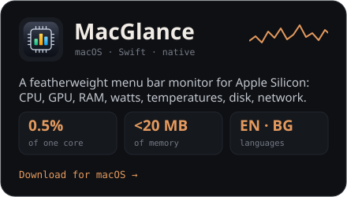

  

Hi, I’m **Kristiyan**, a developer from Bulgaria. I build native macOS apps, desktop tools and self-hosted software, and I like the kind of problem where the hard part stays under the hood and the person using it only sees something simple.

### Things I’ve shipped

  
  

  
  

<!-- shipping:start -->

  

All releases: <a href="https://github.com/itsnotsimple/macglance/releases">MacGlance</a> · <a href="https://github.com/itsnotsimple/craftdock/releases">CraftDock</a>

<!-- shipping:end -->

  

